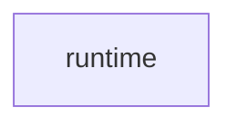

# Runtime architecture reference

The existing [runtime split decision](decisions/issue-1891-runtime-repository-boundary.md)
is the design authority for this repository.
The working name was `OpenRAE/rae-runtime`.
The existing public repository is `OpenRAE/runtime`.
The imported decision and ADRs are unchanged snapshots from RAE commit `9b3146bf4d8a478db3c6b273b1ed90952a239752`.
Their relative links refer to RAE.
Read linked files at that commit in OpenRAE/rae.
SDL and contract authority stay in RAE.

The bootstrap declares only the Go module and an empty package.
It adds no runtime feature or public API.
Schema, storage and security behavior stay the same.
Runtime may consume the released public SDL, processor, contract and portable backend APIs.
RAE product modules must not depend on runtime.
The [public API issue](https://github.com/OpenRAE/rae/issues/1825) owns the exact import and composition interfaces.
The existing checker checks `implementations/architecture.json` against the code and these docs.
Build and test jobs can only read the repository.
They have no publishing credentials.

The [bootstrap source manifest](source-manifest.json) pins reused setup artifacts.
[Issue #1894](https://github.com/OpenRAE/rae/issues/1894) owns the completed runtime import and its source manifest.
Before the move, freeze the completed Go commit.
List each source path and blob in a new manifest.
Use the accepted split decision's local rehearsal and transfer procedure.
Keep the original extraction inventory and published evidence immutable in RAE.
Import the original bytes first.
Record module and import edits in a separate commit.
Keep the licence, notices and author records.
Never rewrite the source history.
Normal publication stays disabled until OpenRAE/rae#1804.

<!-- go-api implementations/go a236139039bc9e8534511663c21517cf76d3d13a00b1843ad5e92aa072688666 -->

<!-- go-view -->

| Layer | Status | Allowed dependencies |
| --- | --- | --- |
| `runtime` | implemented packages |  |

| Package owner | Layer | Cross-layer visibility | Consumer importable | Actual dependencies |
| --- | --- | --- | --- | --- |
| `implementations/go` | runtime | false | true |  |

| Trust-view evidence | SHA-256 |
| --- | --- |
| `docs/decisions/adrs/adr-121-go-engineering-standards.md` | `49217f20d43a33c553797580f6cbc16fb4784e4f0ad207507c7f5dafafcaaae1` |
| `docs/decisions/adrs/adr-122-go-architecture-model.md` | `bb34edd9eb80bb56645ef57f4f48eb3113ac02e95b7af696f32de3bdb8d11fa6` |
| `docs/decisions/issue-1891-runtime-repository-boundary.md` | `e8233ecdf836dbbad4dda9ef373572dd466f1cf59ad0eeb4ab01cc9fd476e406` |
<!-- go-component runtime 3573009f51627c9651e859af77206fbcbaff12ce92a6dd4be61dcfc98b3645d3 -->

<!-- /go-view -->
